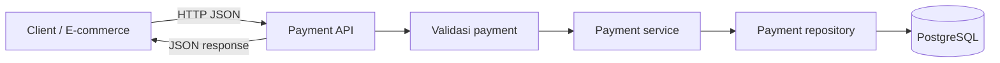
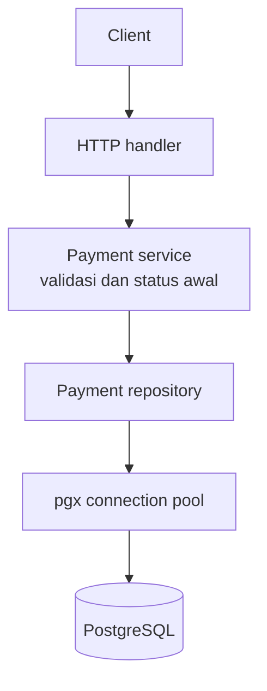

# Financial Payment Integration API - Go

REST API berbasis Go untuk demo B2B sales dan order management terintegrasi dengan inventory serta payment/finance. Kode menyediakan master customer, product, dan warehouse; pembuatan dan konfirmasi sales order; reservasi stok; delivery; pencatatan movement dan activity; serta payment, webhook, dan reporting.

Migration `010_payment_journals_legacy.sql` menyiapkan indeks laporan untuk schema ledger UUID dari migration `006`. Nama file dipertahankan agar deployment yang sudah memakai instruksi sebelumnya tetap mudah diperbarui; migration ini tidak membuat journal legacy.

Customer/account API memakai tabel melalui migration `007`. Payment management, webhook, dan ledger memakai kontrak payment legacy migrations `001`-`004`, dengan ID numerik `BIGSERIAL` dan kolom `reference`. Schema Neon yang memakai UUID `id`, `payment_number`, dan mewajibkan `customer_id` belum kompatibel dengan operasi payment ini; jalankan fitur pada database legacy yang sesuai atau buat migration rekonsiliasi sebelum deployment ke Neon.

## Masalah Bisnis

Aplikasi e-commerce membutuhkan satu pintu integrasi untuk mencatat permintaan pembayaran secara konsisten. API ini menjadi tempat validasi request dan penyimpanan transaksi sebelum integrasi payment provider ditambahkan. Status `PENDING` berarti transaksi tercatat, bukan berarti provider sudah memproses atau menyetujui pembayaran.



## Alur Create Payment

1. Client mengirim `reference`, `amount`, dan `currency` ke `POST /api/v1/payments`.
2. Handler membaca satu objek JSON dan menolak field yang tidak dikenal.
3. Service memvalidasi reference, amount positif, dan kode currency tiga huruf; currency dinormalisasi menjadi huruf kapital.
4. Service menetapkan status awal `PENDING`.
5. Repository menyimpan transaksi. Reference yang sudah digunakan ditolak oleh constraint unik database. Jika header `Idempotency-Key` dikirim, payment dan key dibuat dalam satu transaksi PostgreSQL: kegagalan menyimpan salah satunya me-rollback keduanya. Key yang sudah digunakan menghasilkan `409 Conflict` (request tidak di-replay sebagai response sukses).
6. API mengembalikan transaksi yang tersimpan dengan HTTP `201 Created`.

## Arsitektur Saat Ini



Kode dipisah ke `handler`, `service`, `repository`, `model`, `database`, `config`, dan `queue`. Endpoint health check tersedia di `/health`. Retry queue bersifat in-memory dan belum dijalankan oleh server API.

## Authentication

Jalankan migration `011_create_users.sql` untuk membuat tabel user. Set `AUTH_TOKEN_SECRET` ke secret acak minimal 32 karakter; aplikasi menolak start jika secret tidak tersedia atau terlalu pendek. Password disimpan sebagai hash bcrypt, dan token bearer HMAC-SHA256 berlaku selama satu jam.

- `POST /api/v1/auth/register` menerima `name`, `email`, dan `password` (minimal 8 karakter). Email yang sudah terdaftar menghasilkan `409 Conflict`.
- `POST /api/v1/auth/login` menerima `email` dan `password`; kredensial salah menghasilkan `401 Unauthorized`.
- Request ke endpoint API bisnis memerlukan header `Authorization: Bearer <access_token>`. `/health`, dokumentasi Swagger, endpoint auth, dan webhook payment tetap publik.

Contoh:

```sh
curl -X POST http://localhost:8080/api/v1/auth/register \
	-H 'Content-Type: application/json' \
	-d '{"name":"Demo User","email":"demo@example.com","password":"change-this-password"}'
curl http://localhost:8080/api/v1/customers \
	-H 'Authorization: Bearer <access_token>'
```

Authentication ini mengidentifikasi pengguna dan mengamankan akses dengan token; otorisasi berbasis role dan relasi kepemilikan data belum diterapkan.

## Webhook dan Ledger

Endpoint `POST /api/v1/webhooks/payment` memerlukan header `X-Webhook-Signature` dengan nilai `sha256=<hex HMAC-SHA256 dari raw request body menggunakan WEBHOOK_SECRET>`. Event yang didukung: `payment.success` dan `payment.failed`.

Untuk `payment.success`, satu transaksi PostgreSQL memasukkan event webhook, mengubah status payment dari `PENDING`/`PROCESSING` ke `SUCCESS`, lalu mencatat satu debit dan satu kredit. Unique `event_id` mencegah event yang sama diproses ulang. Ledger ditulis hanya di repository dalam transaksi tersebut; service tidak melakukan posting kedua. Event berbeda untuk payment yang sudah terminal ditolak sebagai transisi status tidak valid.

Webhook dan payment repository masih memakai kontrak payment legacy. Laporan general ledger membaca debit/kredit langsung dari `ledger_entries`, dengan relasi ke transaksi keuangan dan chart of accounts.

Contoh payload:

```json
{
	"event_id": "evt-001",
	"type": "payment.success",
	"reference": "PAY-001"
}
```

Kode akun demo yang dipakai adalah `1010` (debit) dan `2010` (kredit). Ini simulasi posting, bukan integrasi gateway atau chart of accounts produksi.

## API

### Membuat payment (skema legacy)

`POST /api/v1/payments`

Request:

```json
{
	"reference": "PAY-001",
	"amount": 150000,
	"currency": "IDR"
}
```

Response `201 Created`:

```json
{
	"id": 1,
	"reference": "PAY-001",
	"amount": 150000,
	"currency": "IDR",
	"status": "PENDING",
	"created_at": "2026-09-30T03:00:00Z",
	"updated_at": "2026-09-30T03:00:00Z"
}
```

### Melihat semua payment

`GET /api/v1/payments` mengembalikan array dari schema payment legacy. Jika belum ada transaksi, response berupa `[]`.

### Melihat payment berdasarkan ID

`GET /api/v1/payments/{id}` menerima ID numerik `BIGSERIAL`, mengembalikan satu payment, dan menghasilkan `404 Not Found` jika tidak ditemukan.

### Laporan keuangan

- `GET /api/v1/reports/payment-summary?from=2026-10-01&to=2026-10-31` merangkum jumlah payment dan nominal per status serta mata uang.
- `GET /api/v1/reports/daily-payments?from=2026-10-01&to=2026-10-31` mengelompokkan jumlah dan nominal payment per hari serta mata uang. Hari laporan menggunakan UTC.
- `GET /api/v1/reports/general-ledger?from=2026-10-01&to=2026-10-31&account_code=1010` menampilkan debit, kredit, dan saldo berjalan per akun/mata uang.

Semua endpoint menerima `format=csv`, `format=xlsx` (atau `format=excel`), atau `format=pdf` untuk mengunduh laporan. Tanpa parameter format, response tetap JSON. Nama file dikirim melalui `Content-Disposition`.

```sh
curl -OJ 'http://localhost:8080/api/v1/reports/payment-summary?from=2026-10-01&to=2026-10-31&format=xlsx'
curl -OJ 'http://localhost:8080/api/v1/reports/daily-payments?from=2026-10-01&to=2026-10-31&format=csv'
curl -OJ 'http://localhost:8080/api/v1/reports/general-ledger?from=2026-10-01&to=2026-10-31&account_code=1010&format=pdf'
```

Parameter tanggal bersifat opsional dan memakai format `YYYY-MM-DD`; tanggal `to` termasuk seluruh harinya. Nominal dilaporkan terpisah per mata uang tanpa konversi kurs.

### Sales order dan inventory

Alur order: buat customer, product, dan warehouse; catat penerimaan stok; buat order draft; konfirmasi untuk reservasi stok; lalu proses delivery. Nomor order dan delivery dibuat database, sementara setiap perubahan status dan pergerakan stok dicatat sebagai activity atau inventory movement.

- `GET/POST /api/v1/products` untuk melihat dan membuat product.
- `GET/POST /api/v1/warehouses` untuk melihat dan membuat warehouse.
- `GET /api/v1/inventory` untuk melihat stok on-hand, reserved, dan available per product/warehouse.
- `GET /api/v1/inventory/movements?product_id={uuid}&warehouse_id={uuid}&limit=50` untuk audit penerimaan, adjustment, dan delivery; filter bersifat opsional, limit 1-200.
- `POST /api/v1/inventory/movements?type=RECEIPT` untuk menerima stok; gunakan `type=ADJUSTMENT` untuk koreksi positif atau negatif. Body berisi `product_id`, `warehouse_id`, `quantity_delta`, dan `reason`.
- `GET/POST /api/v1/sales-orders` untuk daftar dan membuat order. Total subtotal, tax, dan total dihitung server dari item.
- `GET /api/v1/sales-orders/{id}` untuk detail order beserta item.
- `GET /api/v1/sales-orders/{id}/activity` untuk melihat perubahan status dan aktivitas yang tercatat.
- `GET /api/v1/sales-orders/{id}/deliveries` untuk melihat dokumen delivery beserta item yang dikirim.
- `POST /api/v1/sales-orders/{id}/confirm` dengan `warehouse_id` untuk mengonfirmasi order dan mereservasi stok secara atomik.
- `POST /api/v1/sales-orders/{id}/deliver` dengan `warehouse_id` untuk membuat delivery order, mengurangi stok, menyelesaikan reservasi, dan mengubah status order menjadi `DELIVERED` dalam satu transaksi.

Contoh urutan request:

```sh
curl -X POST http://localhost:8080/api/v1/products -H 'Content-Type: application/json' \
	-d '{"sku":"PUMP-001","name":"Industrial Pump","unit":"UNIT"}'
curl -X POST http://localhost:8080/api/v1/warehouses -H 'Content-Type: application/json' \
	-d '{"code":"WH-JKT","name":"Jakarta Warehouse"}'
curl -X POST 'http://localhost:8080/api/v1/inventory/movements?type=RECEIPT' -H 'Content-Type: application/json' \
	-d '{"product_id":"<product-uuid>","warehouse_id":"<warehouse-uuid>","quantity_delta":25,"reason":"Opening stock"}'
curl -X POST http://localhost:8080/api/v1/sales-orders -H 'Content-Type: application/json' \
	-d '{"customer_id":"<customer-uuid>","currency":"IDR","items":[{"product_id":"<product-uuid>","description":"Industrial Pump","quantity":2,"unit":"UNIT","unit_price":1250000,"tax_rate":11}]}'
curl -X POST http://localhost:8080/api/v1/sales-orders/<order-uuid>/confirm -H 'Content-Type: application/json' \
	-d '{"warehouse_id":"<warehouse-uuid>"}'
curl -X POST http://localhost:8080/api/v1/sales-orders/<order-uuid>/deliver -H 'Content-Type: application/json' \
	-d '{"warehouse_id":"<warehouse-uuid>"}'
```

Konfirmasi gagal dengan `409 Conflict` jika stok tidak cukup atau status order bukan `DRAFT`. Endpoint sales/inventory memakai schema UUID dari migration `008`; konversi quotation, invoice issuance, dan alokasi payment belum termasuk dalam alur ini.

### Customer dan account

- `GET /api/v1/customers` dan `POST /api/v1/customers`
- `GET /api/v1/customers/{id}`
- `POST /api/v1/accounts`
- `GET /api/v1/accounts/{id}`
- `GET /api/v1/customers/{customer_id}/accounts`

Validasi customer/account tersedia di service. Pastikan migration `007_create_customers_and_accounts.sql` sudah dijalankan agar tabel yang dibaca repository tersedia.

### Swagger UI

Setelah server berjalan, buka `http://localhost:8080/docs` atau `http://localhost:8080/swagger/`. OpenAPI JSON tersedia di `http://localhost:8080/swagger/swagger.json`. Ubah port URL jika `APP_PORT` bukan `8080`.

### Status error

- `400 Bad Request`: JSON atau input payment tidak valid.
- `404 Not Found`: ID payment tidak ditemukan.
- `409 Conflict`: reference sudah digunakan.
- `500 Internal Server Error`: kegagalan internal.

## Database

Migration SQL `001`-`007` adalah jalur schema legacy/eksperimental dan mungkin tidak cocok dengan database Laravel/Neon yang sudah memiliki tabel UUID. Migration `010_payment_journals_legacy.sql` menyiapkan indeks laporan untuk ledger UUID yang memiliki `financial_transaction_id`, `chart_of_account_id`, `debit`, `credit`, dan `currency`.

Migration `008_payment_journals_and_reporting.sql` bekerja secara aditif terhadap tabel Laravel yang sudah ada: `customers`, `payments`, `financial_transactions`, `chart_of_accounts`, dan `ledger_entries`. File ini juga menyiapkan fondasi RFQ, quotation, sales order, proforma invoice, sales invoice, pembayaran invoice, produk, gudang, reservasi stok, delivery order, stock movement, nomor dokumen, dan audit trail.

Untuk database dengan schema dari migration `006`, jalankan `010_payment_journals_legacy.sql` setelah migration schema tersebut. Jangan jalankan migration ini pada schema legacy `001`-`004`. Untuk database Laravel yang sudah ada, tinjau kecocokan semua migration dan kolomnya terlebih dahulu; migration SQL ini tidak menggantikan migration PHP Laravel dan belum memiliki runner/ledger versi sendiri.

## Menjalankan

Persyaratan: Go dan PostgreSQL. Atur `DATABASE_URL`, `APP_PORT` (opsional, default `8080`), dan `WEBHOOK_SECRET` (diperlukan untuk menerima webhook). Schema database harus sesuai dengan migration domain yang digunakan API. Untuk schema financial UUID berdasarkan migration `006`, jalankan:

```sh
psql "$DATABASE_URL" -f migrations/010_payment_journals_legacy.sql
```

Migration `010` menambahkan indeks yang dipakai query general ledger UUID. Payment repository dan webhook masih memakai schema legacy; operasi tersebut tetap memerlukan rekonsiliasi sebelum digunakan terhadap database UUID.

Jalankan API dan test:

```sh
go run ./cmd/api
go test ./...
```

Contoh request:

```sh
curl -X POST http://localhost:8080/api/v1/payments \
	-H 'Content-Type: application/json' \
	-d '{"reference":"PAY-001","amount":150000,"currency":"IDR"}'

curl http://localhost:8080/api/v1/payments
curl http://localhost:8080/api/v1/payments/550e8400-e29b-41d4-a716-446655440000
```

Contoh signature webhook dapat dibuat dengan HMAC-SHA256 atas bytes body persis seperti dikirim, menggunakan secret yang sama dengan `WEBHOOK_SECRET`.

## Batasan Saat Ini

- Belum ada integrasi provider pembayaran nyata; webhook demo adalah pemicu perubahan status.
- Idempotency key disimpan atomik bersama payment dan menolak pemakaian ulang, tetapi belum menyimpan dan me-replay hasil request sebelumnya.
- Retry queue adalah utilitas in-memory, belum dihubungkan ke pemrosesan webhook dan hilang saat proses berhenti.
- Posting ledger memakai dua kode akun demo tetap dan tidak mengonversi mata uang.
- Domain finansial lengkap pada migration `005`/`006` masih perlu direkonsiliasi dengan skema payment aktif.
- Gunakan hanya untuk demo/pembelajaran, bukan pemrosesan uang produksi.

